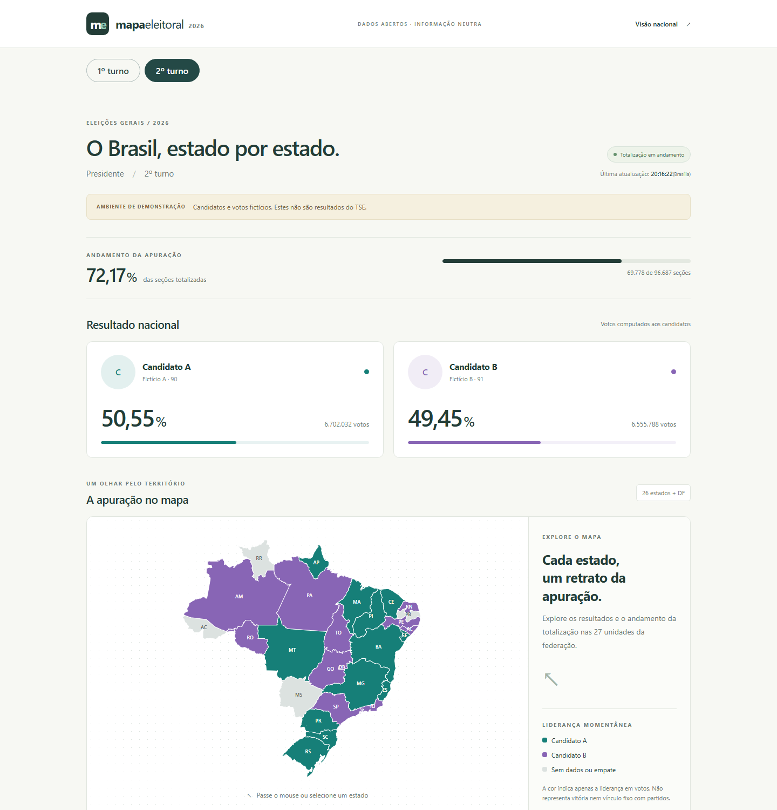

# Mapa Eleitoral 2026

MVP para acompanhar resultados de Presidente, totalização e mapa por UF, com seleção entre primeiro e segundo turnos de 2026. Angular + ASP.NET Core, sem banco de dados. **Ambos os turnos usam TSE real. Enquanto não há resultados do segundo turno, a tela mostra os classificados oficiais do primeiro, sem votos ou percentuais.**



## Requisitos

- Node.js 24.15+ da linha 24 (verificado com 24.18.0) e npm (verificado com 11.16.0).
- SDK .NET 10. O `global.json` aceita feature bands 10.0 a partir de 10.0.100; verificado com 10.0.401.
- Dependências resolvidas no lockfile: Angular 22.2.1, CLI/build 22.2.2, TypeScript 6.0.3 e Vitest 4.1.11. Angular estável compatível foi escolhido conforme o escopo.

## Instalação e execução

Na raiz do projeto, restaure o backend:

```powershell
dotnet restore backend/Election.slnx
dotnet run --project backend/Api
```

API: http://localhost:5080. Nesta máquina, o SDK também está instalado localmente, fora do versionamento; se `dotnet` não estiver no PATH:

```powershell
& .\.tools\dotnet\dotnet.exe run --project backend/Api
```

Em outro terminal:

```powershell
cd frontend
npm ci
npm start
```

Abra http://127.0.0.1:4200/dashboard. O servidor Angular encaminha `/api/**` para o backend; não é necessário CORS no desenvolvimento. `proxy.conf.json` vale apenas para o servidor de desenvolvimento. Em produção será necessário servir os assets e encaminhar `/api` na mesma origem, com HTTPS. Nenhum deploy foi feito.

Se o npm acusar certificado de uma rede corporativa no Node 24, usar o repositório de certificados do sistema, sem desabilitar TLS:

```powershell
$env:NODE_OPTIONS="--use-system-ca --dns-result-order=ipv4first"
npm ci
```

Repositório privado: [jthales/mapa-eleitoral-2026](https://github.com/jthales/mapa-eleitoral-2026). Branch principal: `main`. Clonar com `git clone https://github.com/jthales/mapa-eleitoral-2026.git` usando uma conta autorizada. A hospedagem do site ainda não foi configurada.

## Build e testes

Na raiz:

```powershell
dotnet build backend/Election.slnx
dotnet test backend/Election.slnx
```

No diretório `frontend`:

```powershell
npm run build
npm test
```

Nesta sessão: backend compilado sem avisos, 15 testes xUnit e 12 testes Angular aprovados. Também foram verificados no navegador desktop/celular: 27 UFs, hover, navegação, busca e tela de indisponibilidade. Builds Angular geram `frontend/dist/frontend/browser`.

## Funcionalidades

- Dashboard nacional, progresso das seções, votos e percentuais.
- Seletor de 1º/2º turno preservado na URL, mapa e detalhes; fotos oficiais nos cards, com inicial quando indisponíveis.
- Mapa SVG local das 27 UFs, cores por partido conforme paleta definida pelo usuário, painel ao passar o mouse/focar e navegação para detalhes.
- Busca e lista de estados, com geometria e resultados sem dados em cor neutra.
- API `GET /api/election`, `GET /api/election/states`, `GET /api/election/states/{uf}`.
- UF inválida: HTTP 400; sem primeiro snapshot: HTTP 503. `/health` informa disponibilidade/degradação.
- Worker, cache, timeout, retry limitado e preservação do último dado válido com `dataStatus: stale`.
- Mock explícito com Candidato A/B, 26 estados + DF e algumas UFs sem apuração.

## Mock e TSE real

Configuração em `backend/Api/appsettings.json`: segundo turno usa `UseMockData=false`, `ElectionId="6258"`, intervalo alvo de 10s entre inícios e stale após 30s. Quando a coleta falha (incluindo 404), a próxima tentativa aguarda 600s. Primeiro turno usa `FirstRoundUseMockData=false`, `FirstRoundElectionId="6257"`, atualização de 600s e stale após 1800s. Para desenvolvimento totalmente offline, definir `UseMockData=true` e `FirstRoundUseMockData=true`. Não há fallback silencioso para mock.

**O resultado do segundo turno não estava disponível na consulta de 2026-10-07 (HTTP 404).** A configuração oficial aponta eleição federal `6258`. O adaptador está implementado e foi verificado com dados reais de primeiro turno (`6257`, turno 1), incluindo Brasil e as 27 UFs. Isso não valida resultados futuros do segundo turno.

Use os botões de turno ou abra http://127.0.0.1:4200/dashboard?round=1. As rotas de dados e health aceitam `?round=1` ou `?round=2`; ausência seleciona 2, valor inválido retorna 400. O worker carrega ambos os turnos em caches separados, sem reconfigurar o processo. `Round=2` permanece como padrão interno; não precisa ser alterado para navegar.

Fotos são obtidas pelo backend a partir do diretório `ft` do EA11 e do `sqcand` do EA20, mantidas em memória por 24h e servidas por `/api/election/candidates/{id}/photo?round=1`. Fotos não disponíveis usam a inicial do nome. Mock não usa retratos de pessoas reais. Mais informações e fontes em [integração TSE](docs/tse-integration.md).

## Arquitetura e limites

Angular → API → cache. O worker consulta EA11/EA20, valida e normaliza os dados e publica um snapshot no cache. Nenhuma requisição do usuário inicia consulta ao TSE.

`fresh` significa consulta recente bem-sucedida; não garante uma geração nova no TSE. `updatedAt` preserva a geração do arquivo. Sem cache inicial a API retorna 503; uma falha posterior mantém dados e sinaliza defasagem. Uma falha em qualquer UF impede publicar todo o novo snapshot; veja [arquitetura](docs/architecture.md).

Municípios, Redis, SSE/WebSocket, histórico, testes de carga e deploy ainda não foram implementados. A interpretação do fuso do horário TSE é uma hipótese configurável documentada. Ver [estado atual](docs/current-status.md).

## Fontes e neutralidade

Dados eleitorais reais: [TSE](https://www.tse.jus.br/eleicoes/informacoes-tecnicas-sobre-a-divulgacao-de-resultados). Geometria: [API de malhas do IBGE](https://servicodados.ibge.gov.br/api/docs/malhas?versao=3), preservada localmente com proveniência em [maps/README.md](frontend/public/maps/README.md).

O projeto não recomenda candidatos, atribui notas, faz previsões ou infere vencedores pela liderança. Mocks são identificados; cores seguem a paleta por partido fornecida pelo usuário. Situações dos candidatos são reproduzidas do status oficial quando disponível, sem transformar `e=s` em anúncio de vitória.

## Continuidade

Antes de alterar, ler [AGENTS.md](AGENTS.md) e [current-status.md](docs/current-status.md). Outros documentos em [docs/](docs/): [arquitetura](docs/architecture.md), [roadmap](docs/roadmap.md), [decisões](docs/decisions.md), [convenções](docs/conventions.md) e [sessões](docs/sessions/).

## Espera do segundo turno e carga no TSE

Sem snapshot do segundo turno, a API pode fornecer candidatesOnly=true: exatamente dois candidatos com situação oficial 2º turno em um primeiro turno real e concluído. Votos, percentuais, totais de seções, margem e electionId são null; updatedAt refere-se ao primeiro turno. Fotos mantêm sua origem no primeiro turno. Não é resultado nem mock de segundo turno. Snapshot real de segundo turno sempre tem prioridade. Sem essas condições, retorna 503.

Visitantes leem apenas cache: polling de duas rotas a cada 5s no segundo turno e 30s no primeiro por dashboard, nenhuma chamada ao TSE por visitante. Coleta completa: EA11 + BR + 27 UFs = 29 requisições sequenciais por ciclo, além de fotos/retries quando necessários. Primeiro turno: 600s. Segundo turno: 10s após sucesso; atualmente, 404 nacional interrompe após EA11/BR e usa backoff de 600s. Fotos ficam 24h em memória. Cache/worker são por instância; múltiplas réplicas multiplicam coletas e exigem coordenação futura. Sem teste de carga nesta entrega.
