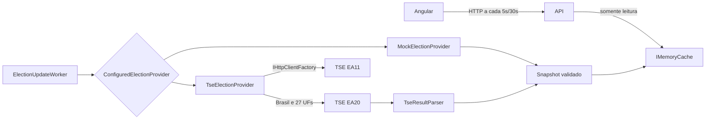

# Arquitetura

MVP implementado em 2026-10-07. Foco: Presidente, apuração e mapa por UF. Pesquisas, propostas, notícias e municípios estão fora desta entrega.

## Estrutura real

```text
frontend/src/app/
  core/models/              contratos normalizados e cores por candidato
  core/services/            ElectionService (HttpClient)
  features/dashboard/       resultado nacional, busca e tabela
  features/map/             SVG e painel de UF
  features/state-details/   detalhes por UF
  shared/                   cabeçalho, progresso e card
frontend/public/maps/       malha original e paths SVG locais
backend/
  Api/                      rotas HTTP, DI, configuração e ProblemDetails
  Application/              DTOs, interfaces e leitura do cache
  Domain/                   snapshot, resultados, matemática e catálogo UF
  Infrastructure/           cache, mock, worker e adaptador Tse/
  Tests/                    xUnit, testes de API e fixtures oficiais
scripts/generate-map.mjs    regeneração determinística da geometria SVG
```

Frontend standalone, signals, SCSS e lazy routes. Backend possui quatro projetos com dependências Api → Infrastructure → Application → Domain. Framework ASP.NET apenas nas bordas; não há banco ou ORM.

## Fluxo



O navegador não consulta TSE ou IBGE. Geometria do IBGE foi baixada na preparação e é servida como asset local.

## Serviços e interfaces

- ITseElectionService/TseElectionService: leitura normalizada do cache para Brasil/UFs/UF; nenhuma chamada externa por usuário.
- IElectionProvider: porta de aquisição de um ElectionSnapshot. ConfiguredElectionProvider escolhe MockElectionProvider ou TseElectionProvider por turno.
- IElectionCache/MemoryElectionCache: leitura, armazenamento e sinalização de stale.
- ElectionUpdateWorker: agenda uma coleta de cada vez; não sobrepõe ciclos.
- TseHttpClient: chamadas HTTPS com espaçamento, timeout, retry limitado e cancelamento.
- TseConfigurationParser: resolve eleição/ciclo e diretório EA20 a partir do EA11; confere cargo Presidente.
- TseResultParser: valida e normaliza EA20. Rejeita fase simulada no modo real, turno/eleição/abrangência incorretos, percentuais inválidos e listas inconsistentes.

## DTOs e rotas

| Rota | Retorno |
| --- | --- |
| GET /api/election | BrazilElectionResultDto |
| GET /api/election/states | coleção de StateElectionResultDto |
| GET /api/election/states/{uf} | StateElectionDetailsDto |
| GET /health | status ok/degraded ou 503 |

CandidateResultDto contém id, number, name, party, votes, percentage e officialStatus. Identificadores/número permanecem strings. Brasil inclui electionId, round, status, updatedAt, fetchedAt, processedPercentage, totalSections, processedSections, candidates, source, dataStatus, hasData e votesReleased.

UF inclui uf/name, eleição/turno/status/data, progresso, candidatos, leadingCandidateId, marginPercentagePoints, source/dataStatus/hasData/votesReleased. Detalhes envolvem o resultado em result e municipalitiesAvailable=false.

As rotas acima aceitam round=1 ou round=2 (padrão 2). Erros usam ProblemDetails: UF ou turno inválido 400, sem snapshot 503, UF válida ausente 404. CancellationToken é propagado. Respostas usam Cache-Control: no-store para não ocultar stale por caches HTTP.

## Cache e atualização

Configuração em backend/Api/appsettings.json:
- Segundo turno: UseMockData=false por padrão; primeiro: FirstRoundUseMockData=false.
- Primeiro turno: FirstRoundRefreshIntervalSeconds=600; FirstRoundStaleAfterSeconds=1800.
- RefreshIntervalSeconds=10; StaleAfterSeconds=30.
- FailureBackoffSeconds=600, inclusive 403/404/429.
- HttpTimeoutSeconds=15, RetryCount=2, RequestSpacingMilliseconds=150.

Uma coleta real lê configuração, Brasil e 27 UFs sequencialmente. Somente o conjunto completamente validado substitui o cache. Assim, uma UF indisponível bloqueia a publicação do conjunto novo. Não existe consulta de município nesta etapa.

Cada turno tem chave, agenda e marca de falha próprias. Um único worker faz as coletas sequencialmente, sem multiplicar chamadas por usuário. O cache não expira por TTL: preserva o último snapshot até reinício/substituição. Falha marca stale imediatamente; ausência de novas consultas por mais de 30s no segundo turno ou 1800s no primeiro também marca stale. Sucesso remove a marca. Snapshot com geração regressiva é rejeitado. Redis permanece futuro.

fresh descreve recência/sucesso da consulta, não novidade dos votos. updatedAt é geração do arquivo; fetchedAt, no resultado nacional, é horário da coleta. Gerações de BR e UFs podem diferir por distribuição upstream. SourceUtcOffsetMinutes interpreta datas sem offset; a hipótese -180 minutos precisa de confirmação oficial.

## Resiliência

Retry apenas para falhas de rede, timeout e HTTP 5xx, com espera exponencial curta. Sem retry imediato para 403/404/429; ciclo falho espera pelo menos 600s. Redirecionamentos HTTP não são seguidos. Configuração real limita origem a resultados.tse.jus.br; templates não podem trocar host.

Sem primeiro snapshot: 503 e Retry-After, exceto a projeção de classificados descrita abaixo. Com snapshot anterior: dados mantidos e stale. Não há fallback silencioso para mock, persistência de cache, limitador distribuído ou coordenação entre réplicas. Política atual se destina a uma instância.

## Matemática e neutralidade

Progresso = seções totalizadas / total de seções. Mock calcula percentuais a partir dos votos fictícios; modo real preserva percentual de votos computados publicado pelo TSE. Margem é diferença entre os dois maiores percentuais, em pontos percentuais; empate/zero votos não tem líder. Liderança não declara vencedor.

dv=n bloqueia exposição de votos/percentuais e marca ausência de dados. and define andamento, sem inferir vitória de 100%. Situação do candidato só é exposta quando tf=s; e=s isolado nunca vira vitória.

## Mapa e UX

SVG sem biblioteca de mapas, com geometria pública do IBGE preservada e conversão reproduzível. Cores vêm de PARTY_MAP_COLORS por sigla de partido normalizada (acentos, caixa e espaços externos), conforme paleta do usuário. Partidos ausentes na paleta usam #69777D; a ordem ou lista de candidatos não muda a cor. UFs sem dados/empate ficam neutras. Painel mostra o resultado nacional por padrão; hover/foco mostra UF com candidatos ordenados por votos, retornando ao Brasil ao sair do estado com mouse ou sair do componente com foco. Empates usam nome apenas para ordenação, sem inferir liderança; clique navega para /states/:uf; tabela pesquisável atende também telas pequenas e teclado.

Estados loading/loaded/error/no-data estão no componente. Polling da API a cada 5s no segundo turno e 30s no primeiro, sem sobreposição; falha preserva os dados visíveis e mostra aviso. Detalhes por estado também são atualizados. Não há SSE/WebSocket. O seletor persiste round na query string; trocar turno cancela a consulta anterior e limpa resultados visíveis até a resposta do novo turno. Links para UF e retorno mantêm a seleção.

## Testes e limites

xUnit valida domínio, parsing, cache, HTTP e endpoints; Vitest valida service/componentes. Fixtures oficiais são exclusivas para testes e têm fonte registrada. Não há teste de carga nem validação operacional do segundo turno. Ver current-status e tse-integration antes de habilitar o modo real.

## Fotos dos candidatos

TseCandidatePhotos resolve o template ft do EA11 e usa sqcand.jpeg na abrangência BR, pois o cargo é Presidente. Download sequencial no worker após validar resultados, MIME/assinatura JPEG e limite de 2 MB; cache por eleição/candidato de 24h. API de foto só lê cache e exige candidato presente no snapshot real. DTO fornece photoUrl local ou null; frontend nunca consulta TSE.

Falha de foto não descarta votos: interrompe o lote de fotos, aplica pausa de 600s e marca aquela imagem indisponível por 24h. Demais imagens são tentadas em ciclos posteriores. Imagens expiradas não são preservadas indefinidamente. O card usa inicial quando ausente ou falha no navegador; todos os retratos têm o mesmo tamanho.

## Resumo nacional

Cards ordenados por votos decrescentes (nome desempata somente a apresentação). Exibir quatro inicialmente, com controle acessível Mostrar mais/menos; resetar expansão ao trocar turno. No primeiro turno, status oficial 2º turno gera badge; Não eleito recebe fundo discreto e foto em cinza, preservando texto e cores partidárias. Ausência de status não implica eliminação, e posição/percentual não implica classificação.

## Candidatos antes dos resultados do segundo turno

TseElectionService consulta somente caches. Na ausência de cache 2, aceita primeiro turno source=tse, status=completed e exatamente dois candidatos com officialStatus=2º turno. Retorna candidatesOnly=true, round=2, electionId=null e métricas de votação/apuração/margem null. Preserva origem, datas, fotos e stale do primeiro turno; não escreve snapshot sintético no cache 2. UFs recebem as mesmas identidades nacionais, nenhuma liderança. UI identifica a proveniência e a espera. Snapshot 2 real tem prioridade, inclusive stale.

Essa leitura não cria requisições ao TSE. Um worker por processo coleta EA11/BR/27 UFs sequencialmente (29 chamadas completas); intervalos 600s primeiro, 10s segundo após sucesso, backoff 600s em falha. Fotos são adicionais com cache 24h. Escalar réplicas requer coordenar workers/cache para evitar duplicação de coletas. /health mede snapshot real; retorna 503 enquanto apenas a projeção está disponível.
